# Lab 1: Your first lakehouse and Delta table

[Workshop home](../../README.md)

**Estimated time:** 25-35 minutes  
**Experience required:** None; this lab uses the Fabric browser interface.

## What you will learn

By the end of this lab, you will be able to:

- Explain the difference between a lakehouse, a file, and a Delta table.
- Download a sample CSV to your laptop.
- Create a Fabric lakehouse and upload the CSV into its **Files** area.
- Load the CSV into a Delta table in the **Tables** area.
- Query the Delta table and insert two rows using the Spark SQL query editor.
- Preview the table and confirm its columns and row count.
- Inspect Delta table history and query an earlier version after truncating the table.

## 1. Understand the concepts

| Concept | What it means in this lab |
| --- | --- |
| OneLake | Fabric's unified data lake storage, where your lakehouse data is stored. |
| Lakehouse | A Fabric item that organizes files and tables, combining flexible data lake storage with table-based analytics. |
| Files | The place to land files such as CSVs before loading or transforming them. |
| Tables | The place to discover and work with registered tables. In this lab, you create a Delta table here. |
| Delta table | A table stored as Parquet data files plus a Delta transaction log. The log tracks committed changes and enables capabilities such as reliable transactions and version history. |

Uploading a CSV does **not** turn it into a Delta table. Loading it into a table
is a separate step.

```text
CSV on your laptop
    |
    | Upload
    v
Lakehouse: Files / products.csv
    |
    | Load to tables
    v
Lakehouse: Tables / dbo / products
    (Parquet data + Delta transaction log)
```

In a lakehouse without schemas enabled, `products` appears directly under
**Tables**, without the `dbo` grouping.

## 2. Check prerequisites

- You can sign in to the [Fabric portal](https://app.fabric.microsoft.com/).
- Your facilitator has provided a workspace on active Fabric capacity or trial.
- You can create lakehouses and upload files in that workspace.
- Your browser can download from GitHub.

Use your assigned workspace. In a shared workspace, use a unique lakehouse name,
such as `lab01_lakehouse_alex`, to avoid changing someone else's work.

## 3. Download the sample CSV

1. Open the [products.csv download link](https://github.com/MicrosoftLearning/dp-data/raw/main/products.csv).

   Alternatively, copy the URL below, paste it into your browser's address bar,
   and press **Enter** to download the file:

   ```text
   https://github.com/MicrosoftLearning/dp-data/raw/main/products.csv
   ```

2. Save the file as `products.csv` in a folder you can find, such as **Downloads**.
   If your browser displays the CSV as text, use **Save as** and keep the `.csv`
   extension. Do not save the page as HTML.

   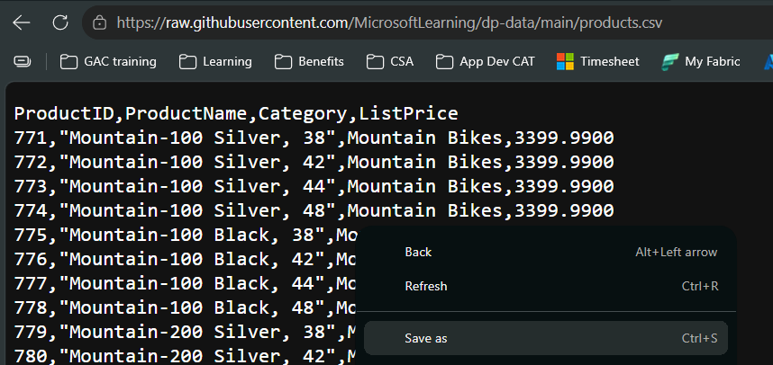

3. Optionally open the file in a text editor to inspect the header:

   ```csv
   ProductID,ProductName,Category,ListPrice
   ```

4. Close the file without editing or resaving it.

The source contains **295 product rows** at the time this guide was prepared.
Product names can contain commas inside quotes; keep the original CSV intact.
If the upstream dataset changes, use the downloaded file's data-row count as
the expected count instead.

**Checkpoint:** You have a local file named `products.csv`, not
`products.csv.html` or `products.csv.txt`.

## 4. Create a lakehouse

1. In the Fabric portal, open your assigned workspace.
2. Select **New item**, search for **Lakehouse**, and select it.

   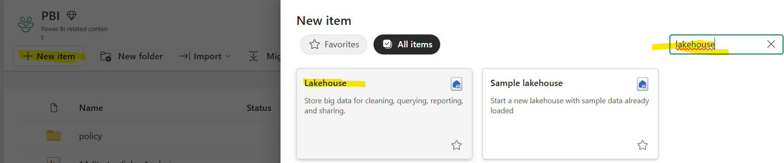

3. Enter a unique name, such as `lab01_lakehouse_alex`.
4. Keep the default schema setting and select **Create**.

   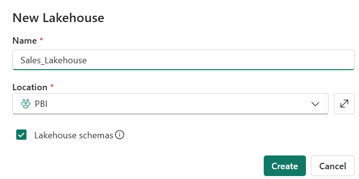

5. In the lakehouse explorer, locate **Files** and **Tables**.

   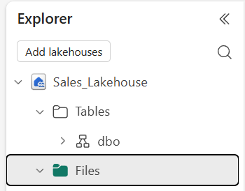

Fabric labels can vary slightly as the portal evolves. If you cannot find an
option, ask the facilitator before changing workspace settings.

**Checkpoint:** Your lakehouse is open and you can see both **Files** and
**Tables**.

## 5. Upload the CSV to the lakehouse

1. Select **Files** in the lakehouse explorer.
2. Use **Upload** > **Upload files** from the toolbar or the **Files** menu.

   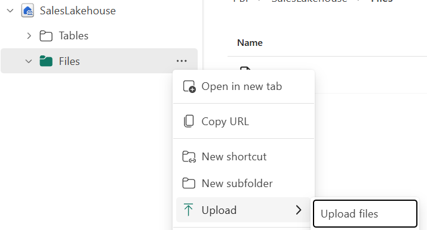

3. Browse to the `products.csv` file on your laptop.

   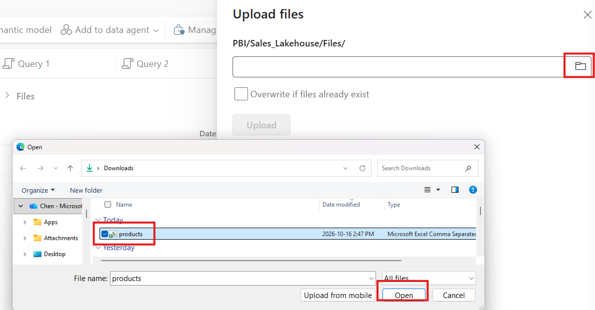

4. Select **Upload** and wait until the upload completes.

   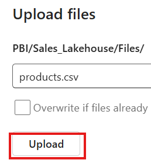

5. Refresh the file list if necessary.

   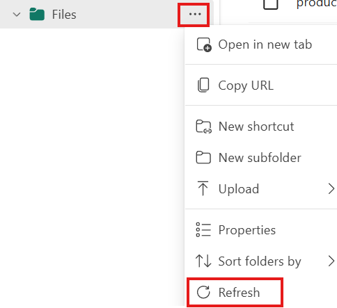

6. Select `products.csv` and inspect its preview.

For this lab, upload directly to the root of **Files** rather than a subfolder.

**Checkpoint:** `products.csv` is visible under **Files**. It is still a CSV,
not a Delta table, and no `products` table has been created yet.

**Discuss:** What changed when you uploaded the file? Where does it now live?

## 6. Load the CSV into a Delta table

There are two ways to create a Delta table from the uploaded CSV:

- **Lakehouse UI:** Use **Load to tables** > **New table** to read the CSV and
  create a Delta table without writing code.
- **Notebook with PySpark:** Attach the lakehouse to a notebook, read the CSV
  with `spark.read.csv(...)`, and write the DataFrame as a Delta table with
  `.write.format("delta").saveAsTable(...)`. This approach lets you transform
  or validate the data before saving it.

Both approaches create a separate Delta table and leave the uploaded CSV
unchanged. **Choose either section A or section B. You only need to complete
the load once.** Both options create the `products` table used in the remaining
exercises.

### A. Load to tables through the UI

1. Open the **...** menu next to `products.csv`.
2. Select **Load to tables** > **New table**.

   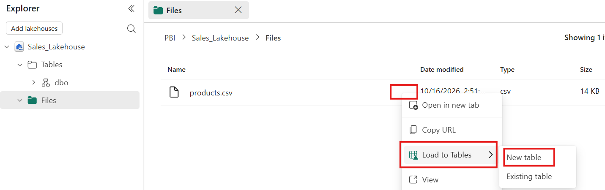

3. Configure the load:

   | Setting | Value |
   | --- | --- |
   | Schema, if shown | `dbo` |
   | New table name | `products` |
   | Column header / Use header for column names | Checked |
   | Separator | Comma (`,`) |

   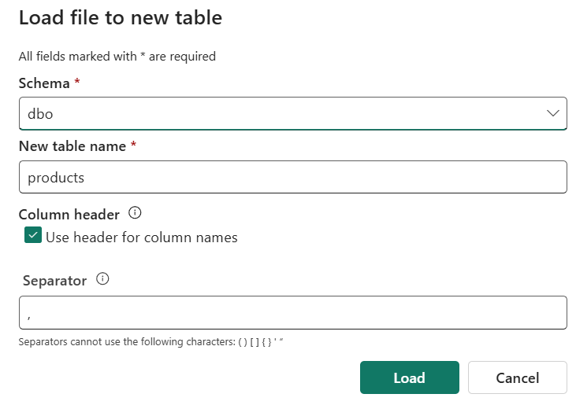

   When starting from a single CSV, the format is determined from the file.
   If a file type option appears, choose **CSV**.

4. Select **Load** and wait for the operation to finish.

   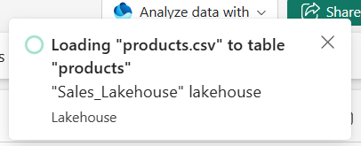

5. Expand or refresh **Tables**. If schemas are enabled, expand **dbo**.

   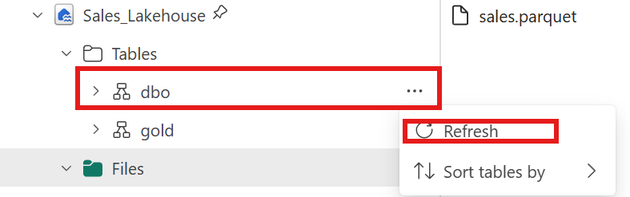

6. Select the new `products` table to preview its data.

   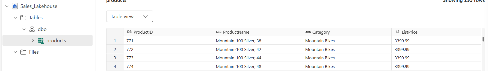

The load reads the CSV and writes a separate Delta table. The original CSV
remains under **Files**.

If `products` already exists, do not append the same file again: that would
duplicate the rows. Use a new table name, such as `products_retry`, and use that
name in the validation query below. Do not overwrite someone else's table.

**Checkpoint:** You can see both the source CSV under **Files** and the new
table under **Tables**.

If you completed section A, skip section B and continue to section 7.

### B. Create a Delta table with a PySpark notebook

1. From the lakehouse, open **Analyze data with** at the top, select
   **Notebook** > **New notebook**.

   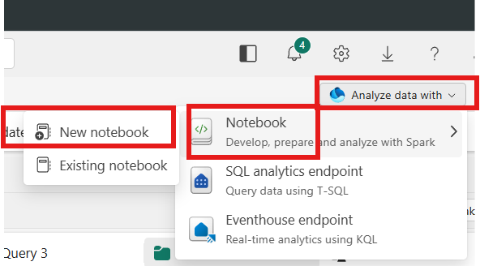

2. The notebook created this way automatically has the lakehouse attached
   in the **Explorer** on the left. Confirm it is your lab lakehouse and is
   pinned as the **default lakehouse**. Expand **Files** and check that
   `products.csv` is present. This is the file the notebook will read.

   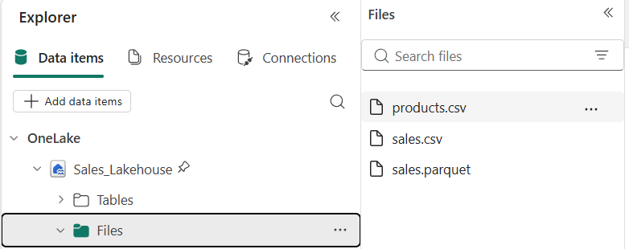

3. In a **PySpark (Python)** code cell, paste and run:

   ```python
   # Read the uploaded CSV, using its header and inferring column types.
   products_df = (
       spark.read
       .option("header", "true")
       .option("inferSchema", "true")
       .csv("Files/products.csv")
   )

   # Preview the source data before writing the table.
   display(products_df)

   # Create a Delta table; fail rather than append or overwrite if it exists.
   (
       products_df.write
       .format("delta")
       .mode("errorifexists")
       .saveAsTable("dbo.products")
   )
   ```

   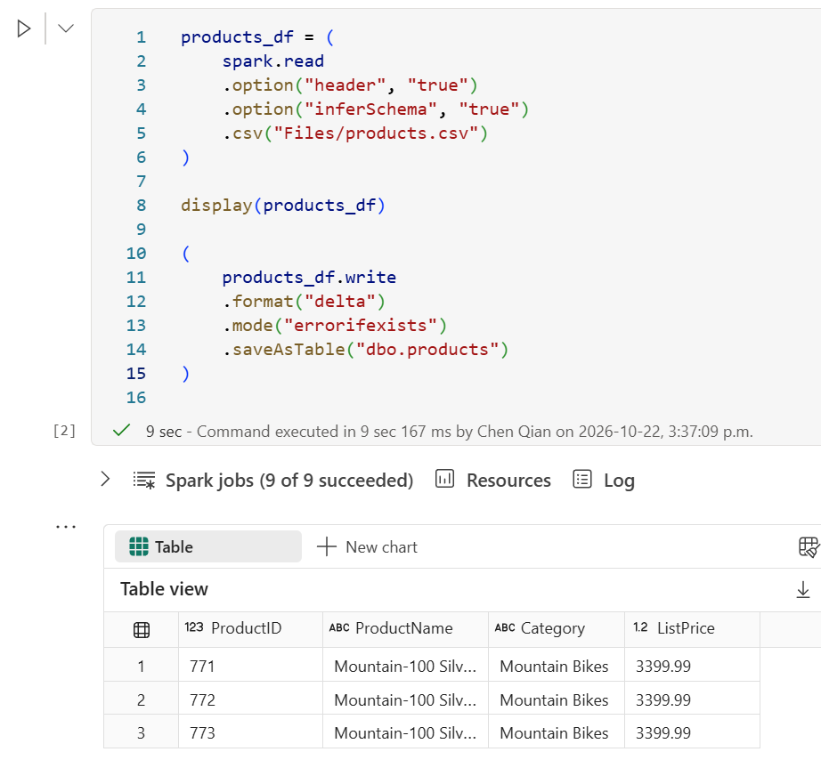

   `header` uses the first CSV row as column names. `inferSchema` asks Spark
   to infer column types from the data. For production workloads, an explicit
   schema gives you more control over types.

   This creates the `products` Delta table from the uploaded CSV.
   `errorifexists` stops the write if
   the destination already exists; it does not append or overwrite data.
   If you already completed section A, skip this cell. If you need a retry
   table, choose a new name and use it in the remaining queries.

4. Save the notebook. Return to the lakehouse, refresh **Tables**, expand
   **dbo**, and preview `products`. You can also refresh from the **...**
   menu beside **dbo** in the notebook's lakehouse Explorer.

   

   After refreshing, expand **dbo** and confirm the `products` Delta table appears.

   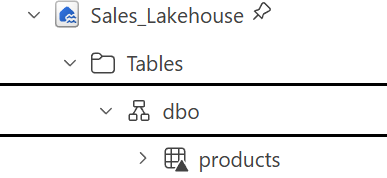

**Checkpoint:** The `products` Delta table contains 295 source rows, and the
original CSV remains under **Files**.

Continue to section 7 using the `products` table created by your chosen approach.

## 7. Analyze data with lakehouse

Use the lakehouse's **New Spark SQL Query** button for these exercises.
Spark SQL can read and write Delta tables. The lakehouse's **SQL analytics
endpoint** supports querying table data, but not inserting rows into it.

### Exercise 1: Count rows and select the top 10 products

1. Open the lakehouse you created and select **New Spark SQL Query**.
2. In the Spark SQL query editor, enter the following query and select **Run**.
   The first run may take
   a few minutes while the Spark session starts.

   ```sql
   SELECT COUNT(*) AS product_count
   FROM dbo.products;
   ```

3. Expect **295** rows for the sample used in this guide. Record this starting
   count; if the source has changed, use your actual count as the baseline.

   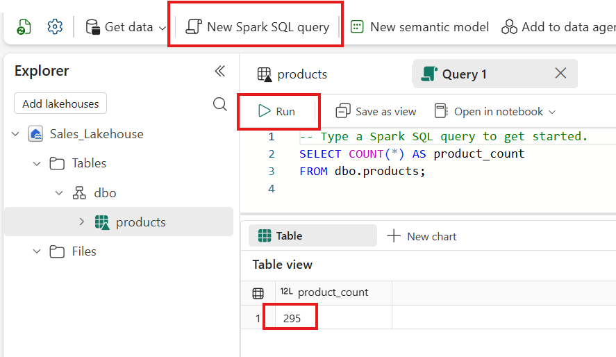

4. Replace the query with the following Spark SQL and select **Run** to display
   the first 10 products by `ProductID`:

   ```sql
   SELECT
       ProductID,
       ProductName,
       Category,
       ListPrice
   FROM dbo.products
   ORDER BY ProductID
   LIMIT 10;
   ```

   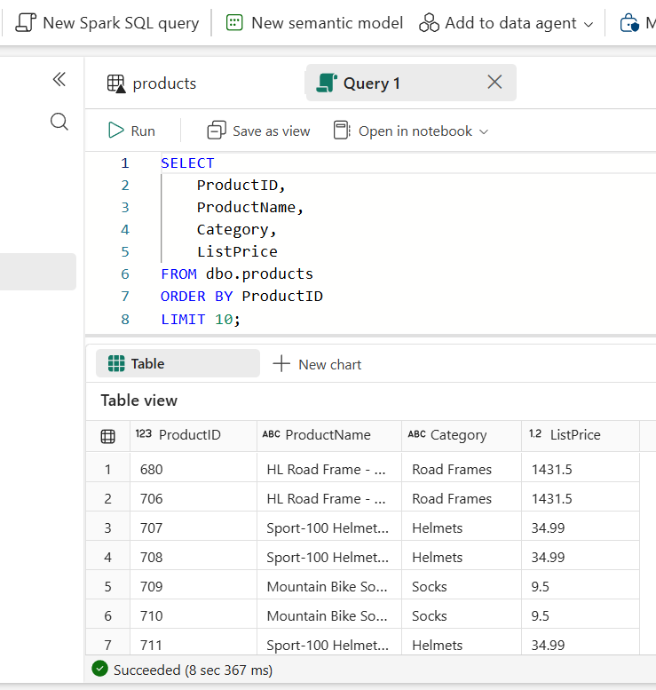

   Spark SQL uses `LIMIT 10` rather than the SQL analytics endpoint's
   `TOP (10)` syntax. Enter SQL directly in this editor; no `%%sql` prefix is
   needed.
   If your lakehouse does not use schemas, use `products` instead of
   `dbo.products` in every Spark SQL query. If you used a different schema or
   retry table name, update the queries accordingly.

**Checkpoint:** You have recorded the starting row count and displayed 10
product records.

### Exercise 2: Insert two more products

Modify only the table in your own lab lakehouse. First check that the sample
IDs below are not already in use by running this query in the Spark SQL query
editor:

```sql
SELECT ProductID, ProductName
FROM dbo.products
WHERE ProductID IN (10001, 10002);
```

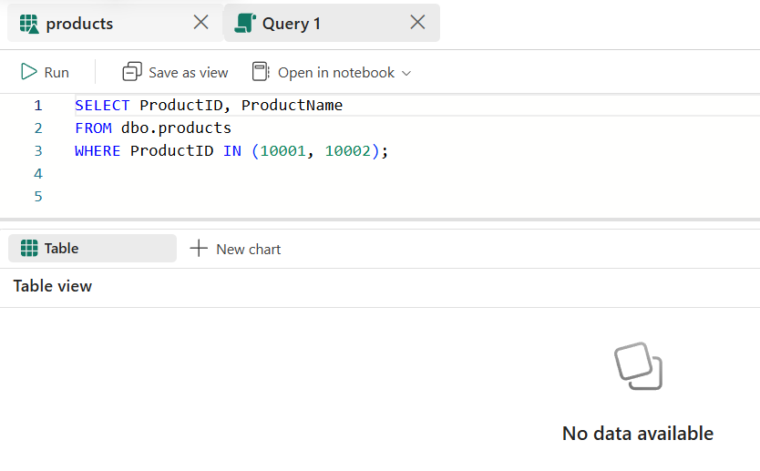

If either ID is returned, stop: you may have already completed this exercise.
Do not run the insert again or overwrite existing products.

1. Replace the query in the Spark SQL query editor with this insert and select
   **Run** **once**:

   ```sql
   INSERT INTO dbo.products (ProductID, ProductName, Category, ListPrice)
   VALUES
       (10001, 'Lab Water Bottle', 'Accessories', 12.99),
       (10002, 'Lab Cycling Cap', 'Clothing', 19.99);
   ```

   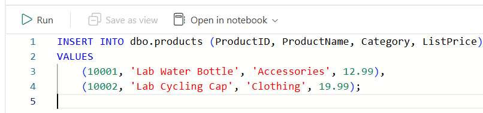

   **Note:** If you accidentally select **Run** multiple times for this insert
   during the lab, that is fine; you do not need to delete anything yet.
   Each successful run adds the same two rows again, so duplicates are expected.
   The expected counts below and in section 8 assume one successful insert.
   If it ran multiple times, expect your starting count plus **2 per successful
   run** instead.

2. Rerun the count query from exercise 1. Expect **297** rows, or your recorded
   starting count plus **2**.
3. Confirm both inserted records:

   ```sql
   SELECT ProductID, ProductName, Category, ListPrice
   FROM dbo.products
   WHERE ProductID IN (10001, 10002)
   ORDER BY ProductID;
   ```

   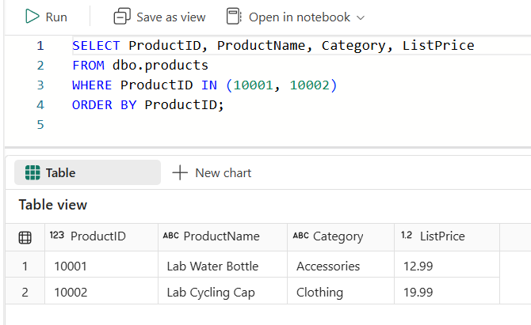

The insert updates the Delta table and its transaction log. It does not modify
the original `products.csv` under **Files**.

**Checkpoint:** The table contains both new products and exactly two more rows
than the starting count.

## 8. Analyze Data with SQL Analytics Endpoint

### Exercise 1: Query the Delta table

1. In the table preview, confirm these four column names:
   - `ProductID`
   - `ProductName`
   - `Category`
   - `ListPrice`
2. Check that names containing commas remain in a single `ProductName` column.
3. Switch from the lakehouse to its **SQL analytics endpoint** using the item
   selector, or open the associated endpoint from your workspace.

   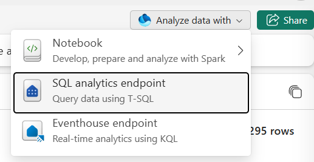

4. Open a **New SQL query** and run:

   ```sql
   SELECT COUNT(*) AS product_count
   FROM dbo.products;

   SELECT TOP (10)
       ProductID,
       ProductName,
       Category,
       ListPrice
   FROM dbo.products
   ORDER BY ProductID;
   ```

   If you selected a different schema or retry table name, update both queries.

5. Expect `product_count` to be **297** after inserting the two products in
   section 7, or your recorded starting count plus **2**.
   The second result should display product records with the four expected
   columns. A table preview can be limited; use the count query to verify the
   full table.

   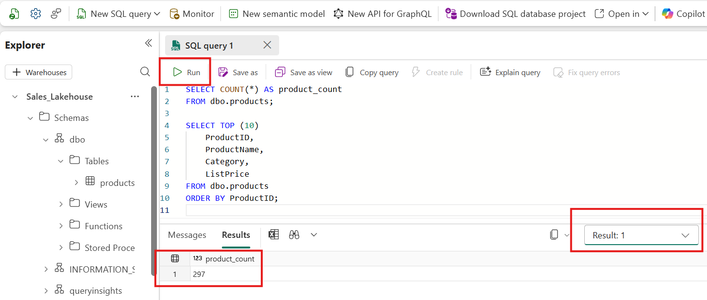

   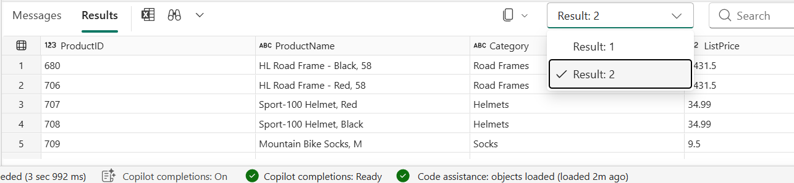

The SQL analytics endpoint can take time to discover a newly created table.
If the table is not yet available, wait briefly, refresh the endpoint explorer,
and retry. The endpoint provides SQL access to the Delta table; it is not a
second copy of your data.

### Exercise 2: Try inserting rows and explain the error

1. Stay in the lakehouse's **SQL analytics endpoint**, not the Spark SQL query
   editor used in section 7.
2. Open a **New SQL query**, enter the same insert from section 7, and select
   **Run**:

   ```sql
   INSERT INTO dbo.products (ProductID, ProductName, Category, ListPrice)
   VALUES
       (10001, 'Lab Water Bottle', 'Accessories', 12.99),
       (10002, 'Lab Cycling Cap', 'Clothing', 19.99);
   ```

   If you used a different schema or retry table name, update the target.

3. Expect an error indicating that inserting into this table is not supported.
   The exact message can vary. This failure is intentional for the exercise;
   it is not caused by the product IDs already being present.

   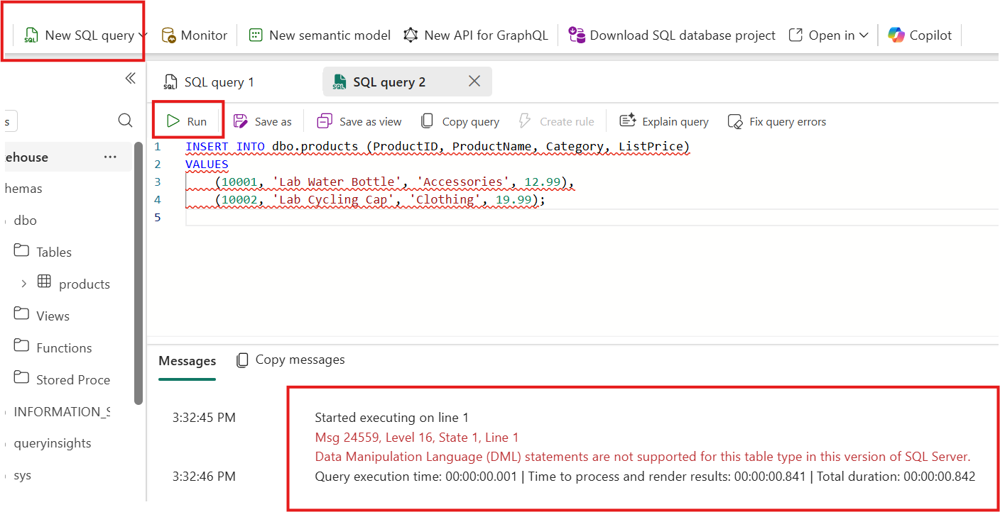

4. Rerun the `COUNT(*)` query from exercise 1. Confirm the count has not changed
   from the value you observed before this attempt.

   ```sql
   SELECT COUNT(*) AS product_count
   FROM dbo.products;
   ```

   **Note:** You can select just the `COUNT(*)` query and then select **Run**.
   Only the selected SQL, highlighted in green in the screenshot below, will
   run rather than the entire script. This lets you check the count without
   rerunning the unsupported `INSERT` statement.

   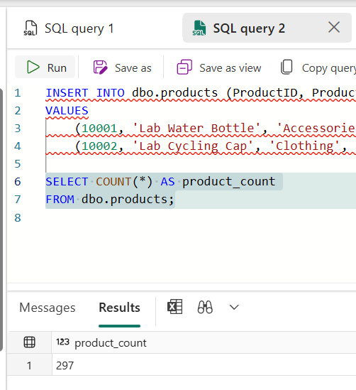

**Why does it fail?** The lakehouse's SQL analytics endpoint provides read-only
T-SQL access to the data in its Delta tables. It does not support `INSERT`,
`UPDATE`, or `DELETE` against those tables. The insert worked in section 7
because Spark SQL can write to the underlying Delta table and commit changes
to its transaction log. The endpoint reads that same table after synchronization;
it does not create a separate writable copy.

This restriction is specific to the lakehouse SQL analytics endpoint, not a
limitation of SQL syntax in general. Granting more permissions will not make
this endpoint support inserts into lakehouse tables. Use the lakehouse's
**New Spark SQL Query** editor when you need to modify this lab's table.

**Checkpoint:** The insert failed as expected, the row count is unchanged, and
you can explain why Spark SQL can modify the table but this endpoint cannot.

## 9. Delta versions and time travel

Now that you have compared the lakehouse and SQL analytics endpoint experiences,
switch back to your **lakehouse** using **Analyze data with** > **Lakehouse**,
or open it from your workspace. Select
**New Spark SQL Query** for the following exercises. Do not run these commands
in the SQL analytics endpoint.

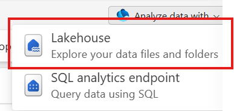

If you used a different schema or retry table name, update every query below.
For a lakehouse without schemas, use `products` instead of `dbo.products`.

### Exercise 1: Describe the table and inspect its history

1. Run the following Spark SQL to inspect the table's columns and data types:

   ```sql
   DESCRIBE TABLE dbo.products;
   ```

   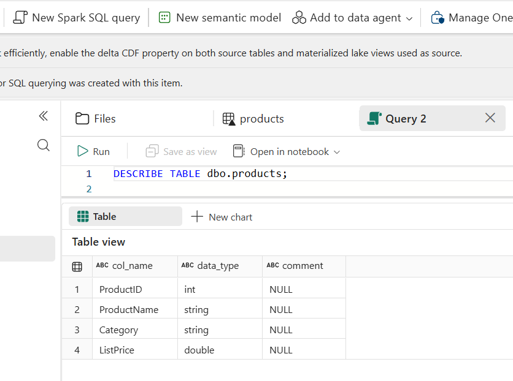

2. Replace the query with the following command and select **Run**:

   ```sql
   DESCRIBE HISTORY dbo.products;
   ```

   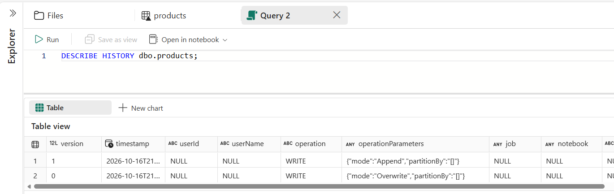

3. Inspect the `version`, `timestamp`, and `operation` columns. Delta versions
   start at **0**. Creating the table and successfully writing changes produce
   history entries; read-only queries do not create new versions.
4. Find **version 1** and record its operation. With one initial load followed
   by one insert, version 1 normally contains the original products plus the
   two inserted rows (**297** rows for this guide's sample). If you performed
   additional writes, use the history to understand what version 1 represents;
   it may not be the latest version.

**Checkpoint:** You can describe the table's schema and identify version 1 in
its Delta history. If version 1 is missing, complete the successful Spark SQL
insert from section 7 before continuing.

### Exercise 2: Truncate the table and query an earlier version

**Warning:** The next command removes **all rows from the current version** of
your table. Run it only against the table in your own lab lakehouse, never a
shared or production table. `TRUNCATE TABLE` empties the table; it does not drop
the table or remove its schema.

1. Run the following Spark SQL:

   ```sql
   TRUNCATE TABLE dbo.products;
   ```

   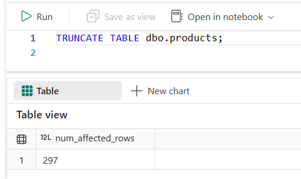

2. Query the current table:

   ```sql
   SELECT *
   FROM dbo.products;
   ```

   Expect **no rows**. The current version is now empty.

   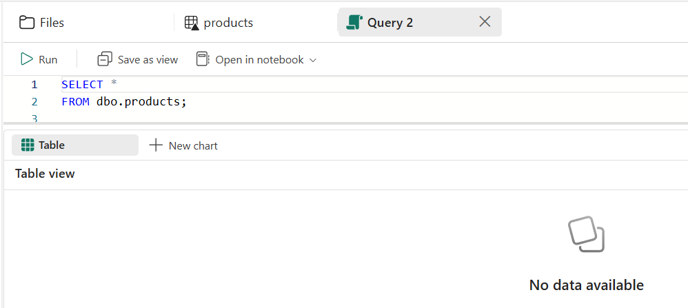

3. Query the earlier snapshot using Delta time travel:

   ```sql
   SELECT *
   FROM dbo.products VERSION AS OF 1;
   ```

   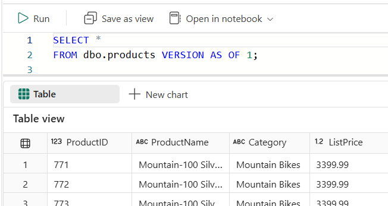

   Expect the rows stored in **version 1**, even though the current table is
   empty. For the normal sequence described above, that snapshot contains
   **297** rows. A results grid may limit the rows it displays; to verify the
   full snapshot count, run:

   ```sql
   SELECT COUNT(*) AS version_1_product_count
   FROM dbo.products VERSION AS OF 1;
   ```

   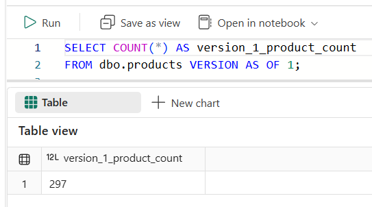

4. Run `DESCRIBE HISTORY dbo.products;` again and locate the new truncate
   operation. Compare its version with version 1.

   ```sql
   DESCRIBE HISTORY dbo.products;
   ```

   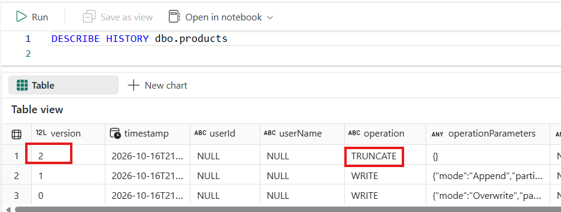

**Why does time travel work?** Delta's transaction log records which data files
belong to each committed version. Truncating the table commits a new, empty
version, while older snapshots can still reference the earlier data files.
`VERSION AS OF 1` reads that snapshot; it does **not** restore rows to the
current table.

Time travel requires both the historical log and its referenced data files to
remain available. Do not run `VACUUM` during this exercise; removing historical
files can make older versions unreadable.

**Checkpoint:** The current table returns no rows, but querying version 1
returns historical product records. Leave the table in this state unless your
facilitator asks you to restore it.

## 10. Explain what you built

Before moving on, explain to a partner:

- How is a lakehouse different from a CSV file?
- Why did uploading the CSV not create a Delta table?
- What makes a Delta table more than a collection of Parquet files?
- Why do both `Files/products.csv` and a `products` table exist?
- Why did the insert succeed with Spark SQL but fail in the SQL analytics endpoint?
- Why can version 1 still return rows after you truncate the current table?

The SQL queries in these exercises are useful for **ad-hoc or one-off
analysis**. When you need to build more complex logic, reuse queries, or share
your work with others, notebooks help organize the steps into a reusable
workflow. In the upcoming lab, you will use a **notebook for data
transformation**.

**Completion checklist**

- [ ] Downloaded the original sample CSV.
- [ ] Created a lakehouse in the assigned workspace.
- [ ] Uploaded the CSV to **Files**.
- [ ] Loaded a `products` Delta table under **Tables**.
- [ ] Queried the table using **New Spark SQL Query**.
- [ ] Confirmed that the SQL analytics endpoint rejects the insert without changing the row count.
- [ ] Inserted two products and confirmed the row count increased by two.
- [ ] Confirmed four column names and the full row count.
- [ ] Inspected the table schema and Delta history.
- [ ] Truncated the current table and queried version 1 using time travel.
- [ ] Can explain the difference between the source file and the Delta table.

## Troubleshooting

| Symptom | What to check |
| --- | --- |
| Download blocked | Ask the facilitator to confirm GitHub access. Do not bypass organizational download policies. |
| Download is an HTML page | Reopen the direct download link and save the CSV content, not the GitHub page. |
| Cannot create a lakehouse | Confirm workspace permissions and active Fabric capacity/trial with the facilitator. |
| Upload option missing | Confirm you opened the lakehouse, not its SQL endpoint, and selected **Files**. Check write permissions. |
| Columns are named `_c0`, `_c1`, etc. | Reload to a new table with **Column header** checked. |
| All data appears in one column | Reload to a new table using comma as the separator. |
| Row count is 590 before the insert exercise, or 592 afterward | The CSV was likely appended twice. Create a new table from a single load. |
| INSERT is not supported | Use **New Spark SQL Query** in your lakehouse, not the SQL analytics endpoint. |
| SQL reports the table does not exist | Confirm lakehouse, schema, and table name; allow endpoint metadata sync and refresh. |

## Cleanup

Keep the lakehouse if the facilitator plans to reuse it in later labs.
Otherwise, delete only the lakehouse you created after confirming with the
facilitator. Do not delete a shared workspace or another participant's items.
Keep or remove the notebook you created in section B as directed by the facilitator.
You can remove your local CSV download after the workshop.

## References

- [Lakehouse overview](https://learn.microsoft.com/en-us/fabric/data-engineering/lakehouse-overview)
- [Lakehouse ingestion options](https://learn.microsoft.com/en-us/fabric/data-engineering/load-data-lakehouse)
- [Load CSV files into Delta tables](https://learn.microsoft.com/en-us/fabric/data-engineering/load-to-tables)
