# Lab 2: Build the medallion Bronze and Silver layers

[Workshop home](../../README.md)

**Estimated time:** 45-55 minutes  
**Experience required:** Basic lakehouse concepts and willingness to run introductory Python.

## What you will learn

- Organize data into Bronze, Silver, and Gold layers.
- Create a Fabric notebook and attach a default lakehouse.
- Read CSV files into a Spark DataFrame with an explicit schema.
- Clean and validate data before saving a Silver Delta table.
- Prepare trusted Silver data for the Gold transformations in Lab 4.
- Compare overwrite, append, and merge, and rerun transformations without duplicate records.

This workshop combines the notebook and DataFrame concepts from
[Analyze data with Apache Spark in Fabric](https://microsoftlearning.github.io/mslearn-fabric/Instructions/Labs/02-analyze-spark.html)
with the layered approach in
[Create a medallion architecture in a Microsoft Fabric lakehouse](https://microsoftlearning.github.io/mslearn-fabric/Instructions/Labs/03b-medallion-lakehouse.html).
The instructions and notebook cells below form a smaller, workshop-specific
workflow: Bronze and Silver in this lab, followed by a Gold aggregate in
[Lab 4](../04-medallion-gold/README.md), rather than the reference lab's full
dimension-and-fact model. Lab 3 defines a date-dimension DataFrame through a pipeline
between these stages. All three labs use the same lakehouse but separate notebooks.

## 1. Understand the medallion architecture

| Layer | Purpose | Implementation across Labs 2-4 |
| --- | --- | --- |
| Bronze | Preserve source data so it can be inspected and reprocessed. | Three unchanged CSV files under `Files/bronze`. |
| Silver | Provide clean, typed, validated detail records. | Delta table `dbo.sales_silver`, one row per order line. |
| Gold | Shape trusted data for a business question. | In Lab 4: Delta table `gold.quarterly_product_sales_gold`, one row per year, quarter, and product, using `gold.date_dimension` created in that lab. |

```text
Files/bronze/*.csv
          |
          | Read, clean, validate, deduplicate
          v
Tables/dbo/sales_silver
          |
          | Join date_dimension; group by year, quarter, and product
          v
Tables/gold/quarterly_product_sales_gold
```

Bronze, Silver, and Gold describe increasing data quality and business readiness,
not three mandatory file formats. This lab uses raw files for Bronze and Delta
tables for Silver and, in Lab 4, Gold. A single lakehouse keeps the exercise manageable;
larger solutions can separate layers into different lakehouses or workspaces.

## 2. Prepare your workspace and source files

Use your assigned workspace on active Fabric capacity or trial. You need
permission to write to your lakehouse, create a notebook, and run Spark.

1. Open and **reuse your existing lakehouse**. Do not create a new
   lakehouse for this lab. Keep its existing files, tables, and schema settings.
2. Download [orders.zip](https://github.com/MicrosoftLearning/dp-data/raw/main/orders.zip)
   and extract it locally. Expect `2019.csv`, `2020.csv`, and `2021.csv`.

   Alternatively, copy the URL below, paste it into your browser's address bar,
   and press **Enter** to download the ZIP file. Extract it after downloading:

   ```text
   https://github.com/MicrosoftLearning/dp-data/raw/main/orders.zip
   ```

   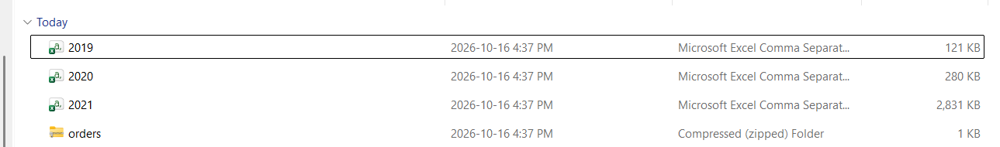

3. Under **Files**, create a `bronze` folder.

   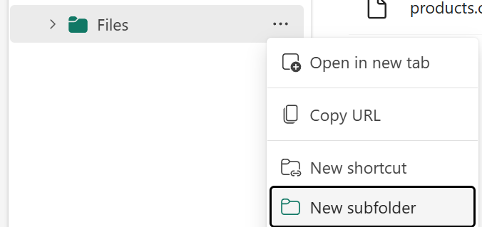

   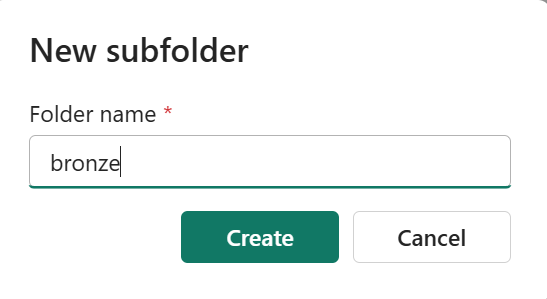

4. Upload the three CSV files directly into **Files > bronze**.
   Upload the extracted CSVs, not the ZIP file.

   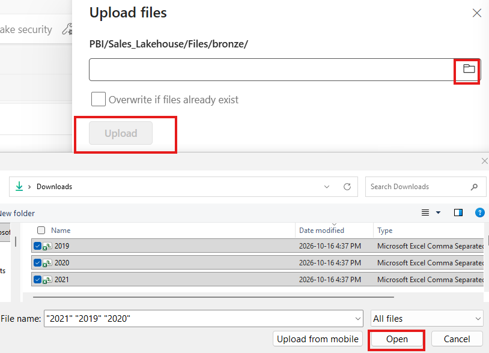

5. Confirm all three filenames before continuing.

   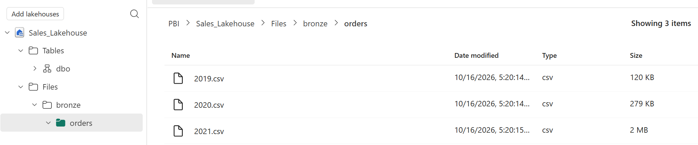

These files contain sales orders. They have **no
header row**; the first line is a record. Product names can contain quoted
commas, so do not edit or resave the files in a spreadsheet.

**Checkpoint:** Your reused lakehouse contains exactly the three order CSV files
directly under `Files/bronze`.

## 3. Create and configure the notebook

1. Return to your assigned **workspace** in the Fabric portal.

   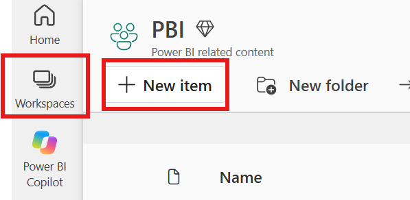

2. Select **New item**, search for **Notebook**, and select it to create a
   blank notebook.

   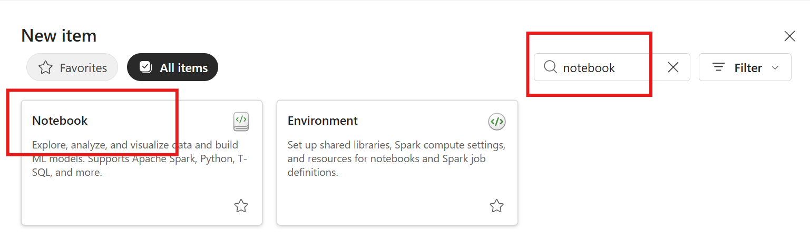

3. In the **New Notebook** dialog, enter the following name, confirm the
   workspace location, and select **Create**. In a shared workspace, append
   your name to keep it unique.

   ```text
   lab02_medallion_transform
   ```

   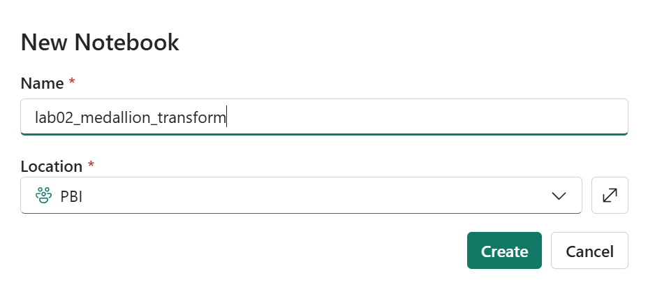

4. In the notebook explorer's **Data items** tab, select **Add data items** >
   **From OneLake catalog**, then select and add the existing **Sales_Lakehouse**
   you created earlier, containing `Files/bronze`. If you used a
   different lakehouse name, select that lakehouse instead.

   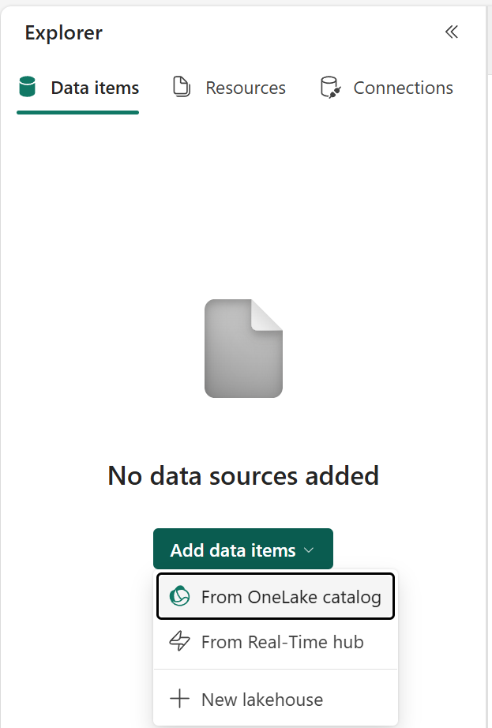

   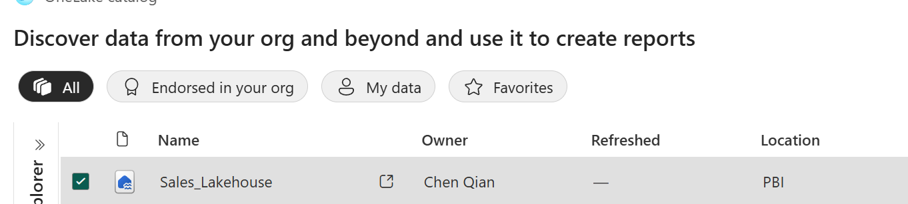

5. Confirm that lakehouse is set as the **default lakehouse**. If necessary,
   open its **...** menu and select **Set as default lakehouse**.
   If you change the default after starting Spark, restart the session.

   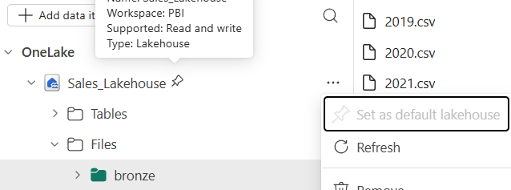

6. Keep the default code language as **PySpark (Python)**.

   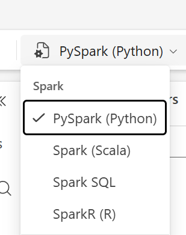

7. Select **Connect > New standard session** and wait for Spark to connect.
   Starting the session may take a few minutes.

   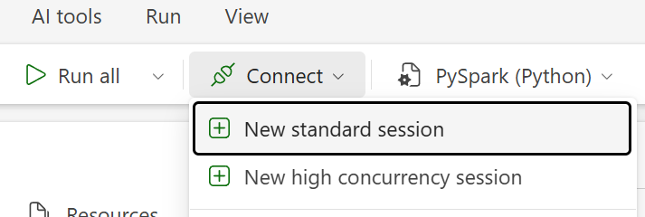

   **What is a high concurrency session?** It allows compatible notebooks or
   pipeline workloads belonging to the same user to share a running Spark
   session. Each workload has isolated execution state, so notebook variables
   do not overwrite one another. Sharing can reduce startup time for subsequent
   workloads and improve compute utilization. The workloads must use the same
   default lakehouse configuration and Spark compute settings; it is not a
   shared session for different workshop participants.

   Use a **standard session** for this lab: you are running one notebook and
   do not need session sharing. See
   [High concurrency mode in Fabric](https://learn.microsoft.com/en-us/fabric/data-engineering/high-concurrency-overview)
   for details.

8. Add a **Markdown** cell and copy the following content into it, then render
   the cell to display the workflow:

   ````markdown
   # Medallion transformation workflow

   Transform raw Bronze order files into a validated Silver Delta table,
   then join a date dimension and aggregate quarterly product sales into Gold.

   ```text
   Files/bronze/*.csv
             |
             | Read, clean, validate, deduplicate
             v
   Tables/dbo/sales_silver
             |
             | Join date_dimension; group by year, quarter, and product
             v
   Tables/gold/quarterly_product_sales_gold
   ```
   ````

   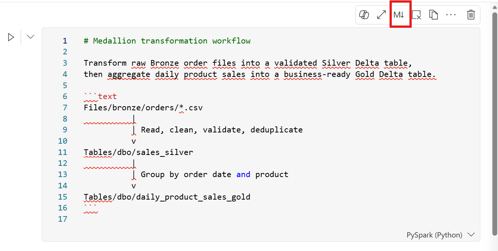

   The rendered Markdown cell should look like this. The screenshot shows the
   earlier folder layout and daily example; use the updated Bronze path and
   quarterly workflow in the copyable text above:

   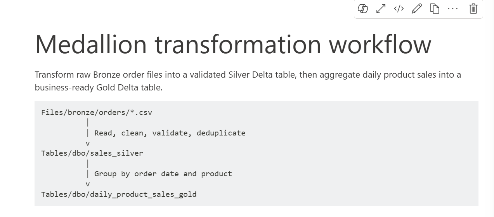

9. Hover just below the bottom of the Markdown cell to reveal **+ Code** and
   **+ Markdown**. Select **+ Code** to insert a code cell. Add a separate code
   cell for each Python block below and run cells in order.

   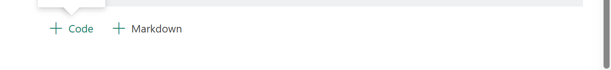

This notebook keeps configuration, transformations,
checks, and outputs together. Save it so you can rerun or share the workflow
with authorized colleagues.

### Configuration cell

Copy the following code into a code cell. To run it, select the **Run** button
to the left of the cell or use a keyboard shortcut:

- **Shift+Enter:** Run the current cell and move to the next cell, creating a
  new cell if there is no next cell.
- **Ctrl+Enter:** Run the current cell and stay in the current cell.

```python
# Import Spark helpers for transformations (F) and explicit data types (T).
from pyspark.sql import functions as F
from pyspark.sql import types as T

# Read all Bronze CSVs and name the Silver output table.
bronze_path = "Files/bronze/*.csv"
# The *.csv wildcard matches every CSV file directly in the bronze folder.
silver_table = "dbo.sales_silver"

# Use the nine business columns to identify exact duplicates, excluding metadata.
order_columns = [
    "SalesOrderNumber", "SalesOrderLineNumber", "OrderDate",
    "CustomerName", "Email", "Item", "Quantity", "UnitPrice", "Tax",
]

# Match the headerless CSV's column order and preserve four decimal places for money.
order_schema = T.StructType([
    T.StructField("SalesOrderNumber", T.StringType()),
    T.StructField("SalesOrderLineNumber", T.IntegerType()),
    T.StructField("OrderDate", T.DateType()),
    T.StructField("CustomerName", T.StringType()),
    T.StructField("Email", T.StringType()),
    T.StructField("Item", T.StringType()),
    T.StructField("Quantity", T.IntegerType()),
    T.StructField("UnitPrice", T.DecimalType(18, 4)),
    T.StructField("Tax", T.DecimalType(18, 4)),
])
```

After running the configuration cell, check the execution status beneath it.
A green check mark indicates success, and the status line shows how long the
cell took to complete, who ran it, and when. Your name, timestamp, and duration
will differ from the example. This cell defines configuration, so no data
table output is expected yet.

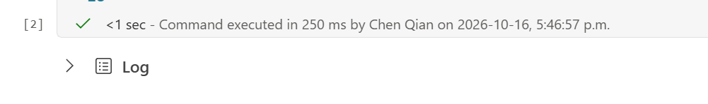

The explicit schema avoids guessing types. Decimal types preserve the sample's
four-decimal monetary precision instead of using floating-point amounts.
For a lakehouse without schemas, remove `dbo.` from the table variables and
from the SQL queries later in this guide.
Lab 3 requires a schema-enabled lakehouse for its separate `gold` schema, so
confirm that prerequisite with the facilitator if you plan to continue.

**Checkpoint:** The notebook is attached to your own lakehouse and the
configuration cell runs successfully.

## 4. Exercise 1: Read and explore Bronze

Run this cell to read all three years without modifying the source files:

```python
# Read headerless Bronze CSVs using the configured schema; stop on malformed input.
bronze_df = (
    spark.read
    .option("header", "false")
    .option("mode", "FAILFAST")
    .option("dateFormat", "yyyy-MM-dd")
    .schema(order_schema)
    .csv(bronze_path)
    # Track the source file for each record without changing the original CSVs.
    .withColumn("SourceFile", F.input_file_name())
)

# Count all source records and stop if there is no data to transform.
bronze_count = bronze_df.count()
if bronze_count == 0:
    raise ValueError("Bronze is empty. Check the upload folder and source files.")

# Inspect the total row count, column types, and a small sample of records.
print(f"Bronze rows: {bronze_count}")
bronze_df.printSchema()
display(bronze_df.limit(10))

# Count records by order year to confirm coverage across the three source files.
display(
    bronze_df.groupBy(F.year("OrderDate").alias("OrderYear"))
    .count()
    .orderBy("OrderYear")
)
```

`FAILFAST` surfaces malformed input rather than silently accepting bad records.
`SourceFile` records the file each row came from.

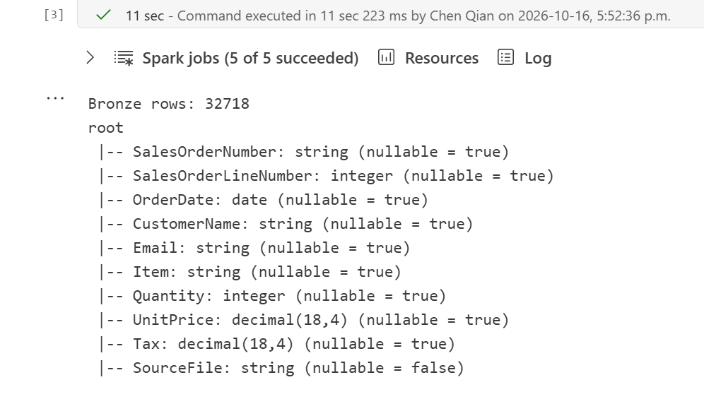

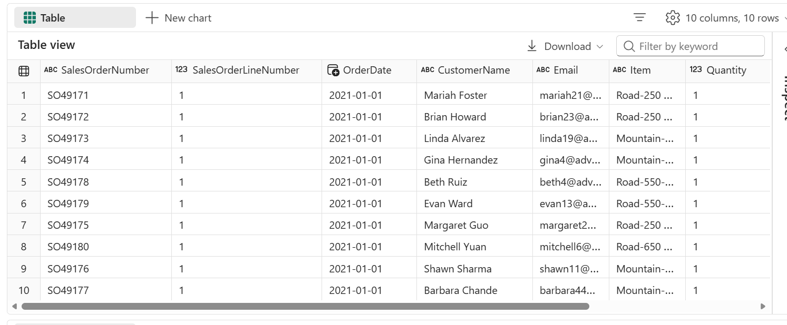

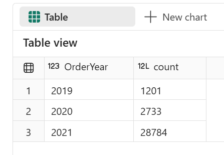

For the sample checked when this lab was authored, expect:

| Year | Rows |
| --- | ---: |
| 2019 | 1,201 |
| 2020 | 2,733 |
| 2021 | 28,784 |
| **Total** | **32,718** |

If upstream data changes, investigate the differences and use the actual
validated source count, rather than forcing the data to match this table.

### Explore built-in visualizations

1. In a table output from this cell, select **+ New chart**.
2. Explore the **Suggested charts** pane. Select a suggestion and choose
   **Start editing** to adjust it, or select **Build my own** to choose your
   own chart type and fields.
3. Try a column chart on the year-count output with **OrderYear** as the
   category and **count** as the value. This compares record counts across
   all three years.
4. Return to the 10-row preview and explore suggestions such as unit price
   or tax by sales order number. Switch back to **Table** to inspect the
   underlying records.

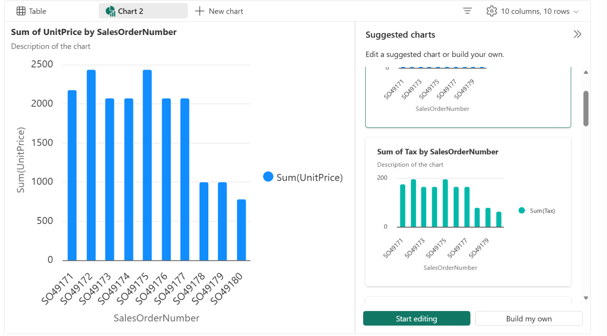

**Note:** Charts use the data returned by that particular `display()` call.
The 10-row preview is only a sample, not the full sales dataset. Suggested
charts are starting points: summing unit prices is not the same as calculating
sales revenue. Later, you will build and chart a Gold table with meaningful
sales measures.

**Discuss:** Why should we preserve Bronze instead of cleaning the CSVs in place?

## 5. Exercise 2: Clean, validate, and write Silver

### Clean the records

Normalize whitespace, supply a label for missing customer names, and normalize
email casing. Keep the original Bronze files unchanged.

```python
# Start from the Bronze DataFrame; transformations leave the source CSVs unchanged.
clean_df = bronze_df
# Remove leading and trailing whitespace from the selected text columns.
for name in ["SalesOrderNumber", "CustomerName", "Email", "Item"]:
    clean_df = clean_df.withColumn(name, F.trim(F.col(name)))

clean_df = (
    clean_df
    # Label missing or blank customer names as Unknown after trimming.
    .withColumn(
        "CustomerName",
        F.when(
            F.col("CustomerName").isNull() | (F.col("CustomerName") == ""),
            F.lit("Unknown"),
        ).otherwise(F.col("CustomerName")),
    )
    # Normalize email casing so equivalent addresses have a consistent form.
    .withColumn("Email", F.lower(F.col("Email")))
)
```

### Validate and deduplicate

For this exercise, an order line must have an order number, positive line number,
valid date, nonempty product, positive quantity, and nonnegative price and tax.
Missing customer names have already been handled; email is not required.

```python
# Define the business rules that every order line must satisfy.
valid_row = (
    F.col("SalesOrderNumber").isNotNull()
    & (F.col("SalesOrderNumber") != "")
    & (F.col("SalesOrderLineNumber") > 0)
    & F.col("OrderDate").isNotNull()
    & F.col("Item").isNotNull()
    & (F.col("Item") != "")
    & (F.col("Quantity") > 0)
    & (F.col("UnitPrice") >= 0)
    & (F.col("Tax") >= 0)
)
# Treat unknown (null) rule results as invalid, not as records to silently skip.
# coalesce returns the first non-null value: keep True/False, or use False for null.
# The ~ operator negates that result so the filter keeps invalid records.
invalid_df = clean_df.filter(~F.coalesce(valid_row, F.lit(False)))
invalid_count = invalid_df.count()
# Show a sample of invalid records and stop before replacing the Silver table.
if invalid_count:
    display(invalid_df.limit(20))
    raise ValueError(f"Found {invalid_count} invalid rows. Resolve them before writing Silver.")

# Remove exact business-record duplicates, ignoring source-file metadata.
silver_df = clean_df.dropDuplicates(order_columns)
silver_count = silver_df.count()
print(f"Exact duplicate records removed: {bronze_count - silver_count}")

# Detect different records that still share the same order-number and line key.
conflicts_df = (
    silver_df.groupBy("SalesOrderNumber", "SalesOrderLineNumber")
    .count()
    .filter(F.col("count") > 1)
)
# Stop rather than arbitrarily choosing which conflicting record to keep.
if conflicts_df.count():
    display(conflicts_df.limit(20))
    raise ValueError("Conflicting records share an order-line key. Resolve them before writing Silver.")

# Calculate sales before tax, record processing time, and add an integer YYYYMMDD date key.
silver_df = (
    silver_df
    .withColumn(
        "LineAmount",
        (F.col("Quantity") * F.col("UnitPrice")).cast("decimal(18,4)"),
    )
    .withColumn("ProcessedAt", F.current_timestamp())
    .withColumn(
        "date_id", F.date_format(F.col("OrderDate"), "yyyyMMdd").cast(T.IntegerType())
    )
)
```

The final transformation adds an integer `date_id` in **YYYYMMDD** format:
for example, `2019-01-01` becomes `20190101`. Keep `OrderDate` as a date column;
the new key will be saved with Silver and used to join the date dimension in
Lab 4.

Exact duplicates are compared using the nine business columns, not `SourceFile`.
Different records with the same order-line key stop the workflow rather than
arbitrarily choosing a winner. In production, invalid records might be sent to a
quarantine table; this introductory notebook stops and shows them explicitly.

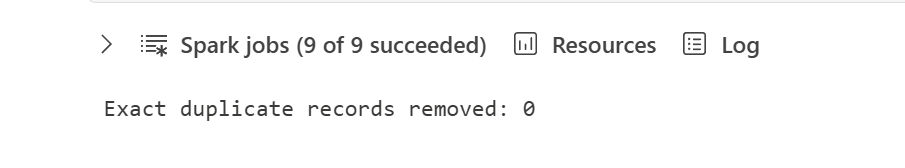

### Persist Silver as Delta

**Write scope:** This lab writes the configured Silver table. The initial
Silver example replaces its output; the later MERGE updates or inserts matching
keys. Lab 3 previews or saves a date dimension in `dbo` through a separate
notebook and pipeline; Lab 4 persists its date dimension and aggregate in `gold`.
Use only your own lakehouse. Preserve unrelated tables and do not point the
notebook at shared or production tables.

```python
# Rebuild the snapshot instead of appending rows on each run.
(
    silver_df.write.format("delta")
    .mode("overwrite")
    .option("overwriteSchema", "true")
    .saveAsTable(silver_table)
)

# Read back the saved table and verify that all validated rows were written.
saved_silver_count = spark.table(silver_table).count()
if saved_silver_count != silver_count:
    raise ValueError("Saved Silver count does not match the validated DataFrame.")

print(f"Saved Silver rows: {saved_silver_count}")
```

**Updating an earlier version of Silver:** If your existing table does not
have `date_id`, rerun the updated transformations and this overwrite cell once.
`overwriteSchema` replaces the lab table's schema as well as its snapshot.
This also removes target-only rows such as the synthetic MERGE example.
Then return to using only the MERGE cell and rerun the two-row mini-exercise
if needed. Do not leave both overwrite and MERGE executable for normal reruns.

### Check before continuing to Lab 3

1. Confirm that the Silver write cell completed successfully.
2. In the notebook's lakehouse explorer, open the **...** menu beside
   **Tables** and select **Refresh**.

   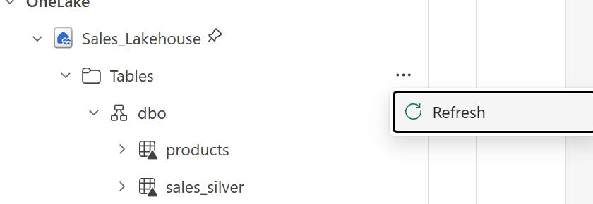

3. Expand **Tables > dbo** and confirm **sales_silver** is listed. Without
   schemas, look directly under **Tables**.
4. Select **sales_silver** and inspect its preview before continuing.
   If it is missing, confirm the default lakehouse, rerun the configuration,
   transformation, and Silver write cells in order, then refresh again.

For the verified sample, Silver contains **32,718** rows with unique
`SalesOrderNumber` and `SalesOrderLineNumber` pairs.

**Checkpoint:** Silver is a persisted Delta table, not just a DataFrame in the
current Spark session. Bronze is unchanged.

### Merge vs Overwrite vs Append

The Silver write above currently uses **`mode("overwrite")`**. Choose a write
strategy deliberately:

| Strategy | What happens | What happens if you rerun the same input? |
| --- | --- | --- |
| **Overwrite** | Replaces the table's current data with the DataFrame's complete snapshot. | Replaces it again; does not append duplicates, but removes existing rows absent from the input. |
| **Append** | Adds every input row without checking business keys. | Adds the same rows again, creating duplicates. Use only when new batches are controlled appropriately. |
| **MERGE** | Matches source and target on a business key, updates matching rows, and inserts new rows. | Updates existing keys rather than adding duplicate copies. Rows missing from the source remain unless deletion is explicitly configured. |

`MERGE` is a Delta operation, not a `.mode("merge")` option. It requires a
reliable key and a source with at most one record per key. Our validation
already checks the **SalesOrderNumber + SalesOrderLineNumber** key.

1. Add a **new PySpark code cell** immediately after the Silver table check.
2. Copy the following merge-based write logic into it.
3. After trying the new cell, remove the earlier overwrite code cell from the
   notebook, or convert it to Markdown for reference. Keep only the new Silver
   write cell executable so **Run all** does not overwrite Silver before merging.

```python
from delta.tables import DeltaTable

if not spark.catalog.tableExists(silver_table):
    # Bootstrap the Delta table on a first run without replacing existing data.
    silver_df.write.format("delta").mode("errorifexists").saveAsTable(silver_table)
else:
    # Match validated order-line keys, update existing rows, and insert new rows.
    target = DeltaTable.forName(spark, silver_table)
    (
        target.alias("target")
        .merge(
            silver_df.alias("source"),
            "target.SalesOrderNumber = source.SalesOrderNumber "
            "AND target.SalesOrderLineNumber = source.SalesOrderLineNumber",
        )
        .whenMatchedUpdateAll()
        .whenNotMatchedInsertAll()
        .execute()
    )

# Check that the target still has only one row per business key.
saved_silver = spark.table(silver_table)
duplicate_keys = (
    saved_silver.groupBy("SalesOrderNumber", "SalesOrderLineNumber")
    .count()
    .filter(F.col("count") > 1)
)
if duplicate_keys.count():
    display(duplicate_keys.limit(20))
    raise ValueError("Silver contains duplicate order-line keys. Investigate before building Gold.")

print(f"Saved Silver rows after MERGE: {saved_silver.count()}")
```

4. Run the new cell twice. For the unchanged workshop
   sample, expect **32,718** rows after each run and no duplicate keys.
5. Refresh **Tables** again and confirm `sales_silver` is still available
   before continuing to Lab 3.

This merge updates all matching columns, including `ProcessedAt`, so reruns can
create new Delta versions even when business values are unchanged. It does not
remove target rows missing from the source, resolve preexisting target
duplicates, or automatically detect new files. This notebook still reads all
Bronze files; a merge alone is not a complete incremental-ingestion solution.

### Mini-exercise: Merge one existing row and one new row

Add a new PySpark cell after the merge cell. Create a two-row DataFrame named
`new_silver`: one row copied from the persisted Silver table and one synthetic
order line with a new order number. A DataFrame is sufficient here; you do not
need to save a separate staging table.

This exercise performs a real write to the Silver table.

```python
from delta.tables import DeltaTable

# Reserve a recognizable order number so reruns update the same demo record.
demo_order = "LAB02-MERGE-001"
before_count = spark.table(silver_table).count()
demo_exists = (
    spark.table(silver_table)
    .filter(F.col("SalesOrderNumber") == demo_order)
    .limit(1)
    .count() > 0
)

# Choose an existing non-demo order line so the two source keys stay distinct.
existing_row = (
    spark.table(silver_table)
    .filter(F.col("SalesOrderNumber") != demo_order)
    .orderBy("SalesOrderNumber", "SalesOrderLineNumber")
    .limit(1)
)
if existing_row.count() == 0:
    raise ValueError("Silver has no existing order line. Complete the Silver write first.")

# Copy its valid values, changing the order number to create a new business key.
new_row = (
    existing_row
    .withColumn("SalesOrderNumber", F.lit(demo_order))
    .withColumn("SourceFile", F.lit("Synthetic merge exercise"))
    .withColumn("ProcessedAt", F.current_timestamp())
)
new_silver = existing_row.unionByName(new_row)
display(new_silver)

# Update the existing key and insert only the new key.
(
    DeltaTable.forName(spark, silver_table).alias("target")
    .merge(
        new_silver.alias("source"),
        "target.SalesOrderNumber = source.SalesOrderNumber "
        "AND target.SalesOrderLineNumber = source.SalesOrderLineNumber",
    )
    .whenMatchedUpdateAll()
    .whenNotMatchedInsertAll()
    .execute()
)

# Expect +1 on the first run; reruns match both keys and add no further rows.
after_count = spark.table(silver_table).count()
expected_increase = 0 if demo_exists else 1
print(f"Silver before: {before_count}; after: {after_count}")
print(f"Row count change: {after_count - before_count} (expected +{expected_increase})")
if after_count != before_count + expected_increase:
    raise ValueError("Unexpected Silver row count after merging the two-row batch.")
```

**Expected result:** On the first run, the two-row batch increases Silver by
**one row**, not two: the copied row matches an existing key and the synthetic
row introduces a new key. With the verified sample, Silver increases from
**32,718 to 32,719** rows. Rerunning the cell adds **zero** rows because the
demo key now exists.

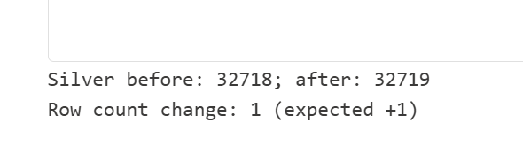

The synthetic row is not added to Bronze. The main Silver merge retains it
because that merge does not delete target rows absent from its source.
Gold will include this extra line in its totals when you complete Lab 4; its
date and product are copied from an existing group, so the number of Gold
groups should remain unchanged.

## Cleanup

Keep the notebook, Bronze files, and Silver table through Labs 3 and 4. After
the planned labs, follow the
[Lab 4 cleanup instructions](../04-medallion-gold/README.md#cleanup)
only after confirming with the facilitator.

**Lab 2 complete:** Save the notebook and keep your Bronze files and Silver
table. Create a new notebook in
[Lab 3: Pipeline basics](../03-pipeline/README.md), then continue to Lab 4 for Gold.
Do not clean up these shared items before completing all planned labs.
